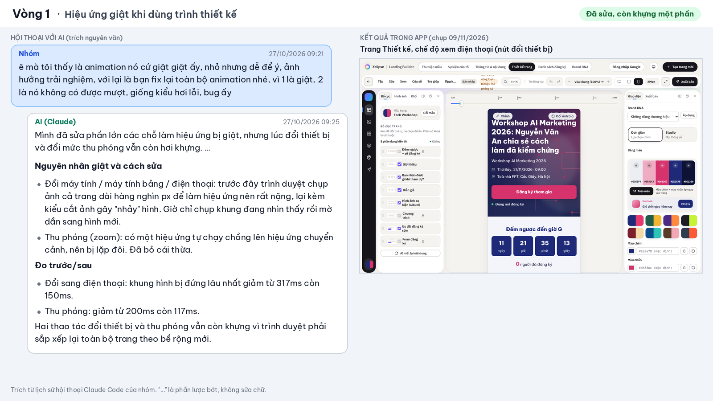
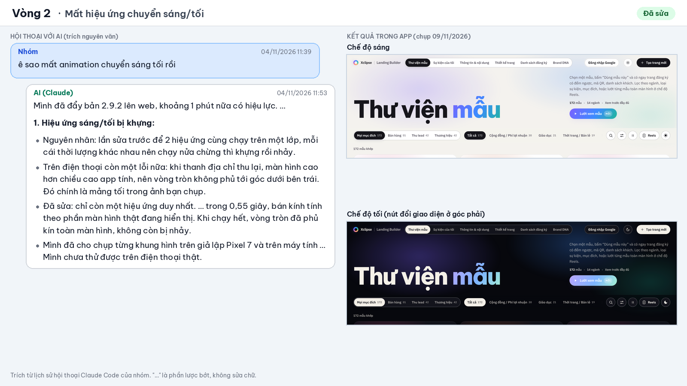
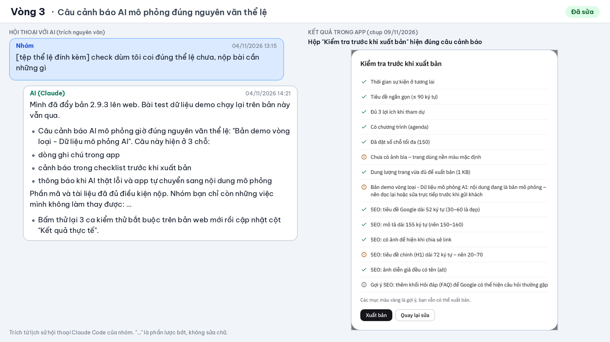
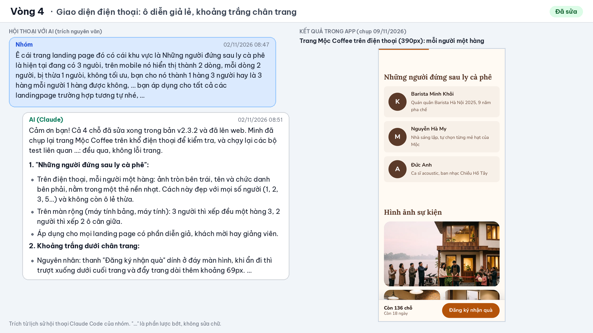
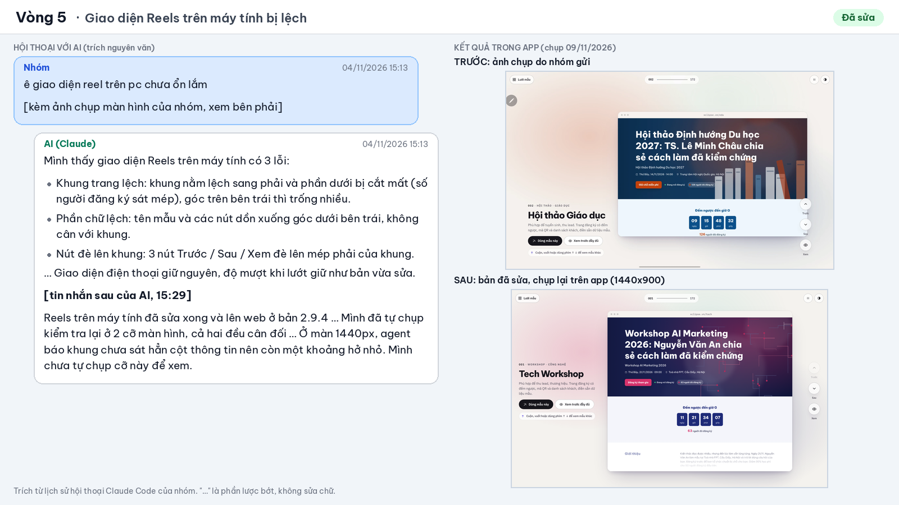

# Minh chứng dùng AI để xây dựng và cải thiện sản phẩm — Xclipse

> Tối đa 1 trang, 5 ảnh chọn lọc. Mỗi vòng: mục tiêu → yêu cầu cho AI → vấn đề phát hiện khi thử → yêu cầu sửa → kết quả kiểm tra lại. Mỗi ảnh: bên trái là đoạn hội thoại thật với Claude (trích nguyên văn từ lịch sử phiên làm việc, "…" là phần lược bớt), bên phải là ảnh chụp app thật sau khi sửa. Bản in 1 trang: [minh-chung-ai.pdf](evidence/minh-chung-ai.pdf).

**Công cụ AI đã dùng**: Claude (lập kế hoạch, viết mã, kiểm thử), Gemini Deep Research (nghiên cứu thị trường, bảng màu), Gemini (tạo ảnh mockup giao diện), AI agent trên trình duyệt (thiết lập Firebase, GitHub Pages).

| # | Mục tiêu | Yêu cầu cho AI | Vấn đề phát hiện khi thử | Yêu cầu sửa | Kết quả kiểm tra lại |
|---|---|---|---|---|---|
| 1 | Hiệu ứng mượt khi dùng trình thiết kế | Viết hiệu ứng cho kéo thả, thu phóng, đổi thiết bị | Nhóm thấy hiệu ứng "giật giật", không mượt, giống lỗi | "fix lại toàn bộ animation" | AI tìm 5 nguyên nhân, sửa và đo lại: đổi sang điện thoại 317ms còn 150ms, thu phóng 200ms còn 117ms; AI ghi rõ còn khựng một phần  |
| 2 | Chuyển giao diện sáng/tối có hiệu ứng | Thêm hiệu ứng vòng tròn loang khi đổi sáng/tối | Lần sửa trước làm mất hiệu ứng (2 hiệu ứng chạy chồng lên nhau, khựng rồi nhảy; điện thoại không phủ kín góc) | "sao mất animation chuyển sáng tối rồi" | Còn một hiệu ứng duy nhất, chụp từng khung hình trên giả lập Pixel 7 và máy tính; AI nói rõ chưa thử trên điện thoại thật  |
| 3 | Đúng thể lệ cuộc thi | Đối chiếu thể lệ (tệp .mht) với sản phẩm và hồ sơ | Câu cảnh báo AI mô phỏng chưa đúng nguyên văn thể lệ | Đổi đúng câu "Bản demo vòng loại - Dữ liệu mô phỏng AI" ở mọi nơi | Câu đúng nguyên văn hiện ở 3 chỗ (ghi chú trong app, checklist xuất bản, thông báo khi AI lỗi)  |
| 4 | Landing page đẹp trên điện thoại | Dựng landing page Mộc Coffee làm mẫu đã xuất bản, tối ưu cho điện thoại | Phần diễn giả xếp 2+1 ô lẻ, có dải trắng dưới chân trang, nút và địa chỉ bị rớt dòng | Xếp lại cho mọi số người, áp dụng cho mọi landing page | Mỗi người một hàng trên điện thoại, trang kết thúc đúng chân trang; AI chụp lại khổ điện thoại và chạy lại test  |
| 5 | Chế độ lướt mẫu (Reels) đẹp trên máy tính | Làm Reels toàn màn hình | Nhóm gửi ảnh chụp: khung lệch, chữ dồn góc, 3 nút đè lên khung | "giao diện reel trên pc chưa ổn lắm" | Bố cục 3 cột cân đối; AI chụp lại ở 1000px và 1920px, nói rõ chưa tự chụp ở 1440px  |

**Bổ sung**: tính năng tạo ảnh bằng Gemini/Imagen trong Thư viện ảnh được Claude viết và kiểm thử bằng mock API; ảnh AI luôn có nhãn "AI" và nhắc ghi "Ảnh minh hoạ tạo bằng AI".

**Bài học**: AI sửa xong vẫn có thể làm hỏng chỗ khác (vòng 2) hoặc chỉ sửa được một phần (vòng 1), nên nhóm luôn tự mở app, thử lại ở điều kiện thật và đối chiếu thể lệ (vòng 3) rồi mới chốt.
